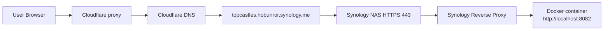

# Topcastles Domain Configuration (topcastles.eu → Synology NAS)

## Purpose

This document describes how to configure the domain `topcastles.eu` to point to a Synology-hosted application running in Docker, using Synology DDNS and Reverse Proxy.

---

## Current Architecture

- Public entrypoint:  
  https://topcastles.eu and https://www.topcastles.eu

- Edge provider and authoritative DNS:
  Cloudflare

- Origin endpoint:
  Synology NAS using `topcastles.hobunror.synology.me`

- Synology Reverse Proxy:
  HTTPS `topcastles.eu` / `www.topcastles.eu` on port `443` -> `http://localhost:8082`

- Application:
  Docker container running on port `8082`

## Architecture Diagram

### Request Flow

1. User opens: https://topcastles.eu
1. Cloudflare receives the request for the proxied hostname.
1. Cloudflare connects to the Synology origin over HTTPS on port `443`.
1. Synology receives the request only from Cloudflare IP ranges.
1. Reverse proxy forwards: https://topcastles.eu -> http://localhost:8082
1. Docker serves: Topcastles Angular/Node app

---

## Goal

Allow users to access the application via:

https://topcastles.eu  
(and optionally https://www.topcastles.eu)

Without exposing internal IP addresses.

---

## Key Principle

Do NOT use:
- Local IPs (e.g. 192.168.x.x)
- Hardcoded public IPs

Use Synology DDNS (`*.synology.me`) as the stable endpoint.

---

## DNS Configuration

As built on 2026-09-15: Strato remains the registrar, and Cloudflare is the
authoritative DNS provider. Public resolver checks now return the Cloudflare
nameservers and Cloudflare proxy IP addresses for the public hostnames.

Configured Cloudflare nameservers:

- `amanda.ns.cloudflare.com`
- `harvey.ns.cloudflare.com`

Previous Strato nameservers:

- `docks06.rzone.de`
- `shades02.rzone.de`

Configured Cloudflare DNS records:

| Name            | Type    | Target / value                    | Proxy status | Notes                                             |
| --------------- | ------- | --------------------------------- | ------------ | ------------------------------------------------- |
| `topcastles.eu` | `CNAME` | `topcastles.hobunror.synology.me` | Proxied      | Cloudflare supports CNAME flattening at the root. |
| `www`           | `CNAME` | `topcastles.hobunror.synology.me` | Proxied      | Serves `www.topcastles.eu`.                       |

The previous direct public-IP `A` record for `84.80.47.69` is no longer part of
the desired Cloudflare DNS state for the public website.

SPF status: no SPF TXT record was visible during DNS verification. If the domain
does not send email, the intended SPF value is `v=spf1 -all`.

Verified public DNS results on 2026-09-15:

| Check | Result |
| --- | --- |
| `topcastles.eu` NS via `1.1.1.1` | `amanda.ns.cloudflare.com`, `harvey.ns.cloudflare.com` |
| `topcastles.eu` A via `1.1.1.1`, `8.8.8.8`, `9.9.9.9` | Cloudflare IPs `104.21.36.7` and `172.67.182.173` |
| `www.topcastles.eu` A via `1.1.1.1` | Cloudflare IPs `104.21.36.7` and `172.67.182.173` |
| `topcastles.eu` TXT/SPF via `1.1.1.1` | No SPF TXT record visible during verification |

## SSL Certificate

As built on 2026-09-15: Cloudflare SSL/TLS mode is **Full (strict)**. The
Synology origin presents a valid certificate for `topcastles.eu` and
`www.topcastles.eu`.

Cloudflare proxied HTTPS uses standard origin port `443`; the public site does
not rely on `:440`.

Verified HTTP results on 2026-09-15: `https://topcastles.eu/` and
`https://www.topcastles.eu/` return Cloudflare headers including
`Server: cloudflare`, `CF-RAY`, and `cf-cache-status`.

## Synology NAS Firewall

As built on 2026-09-15: DSM firewall rules restrict direct origin web traffic.

- The local LAN subnet `192.168.2.0` with subnet mask `255.255.255.0` is allowed
  for NAS administration.
- Cloudflare IPv4 ranges are allowed to TCP ports `80` and `443`.
- All other sources are denied to TCP ports `80` and `443`.
- IPv6 Cloudflare ranges were not added because IPv6 is not used for this setup.

Rule order is significant: LAN allow rules and Cloudflare allow rules must stay
above the deny rule for ports `80` and `443`.

Remaining security verification: direct origin access through
`https://topcastles.hobunror.synology.me/` and the known origin IP still works
from the allowed LAN. From an external network, those direct-origin paths should
be blocked by the DSM firewall; if they still return the Topcastles site, the
firewall profile, interface assignment, or rule order needs correction.
