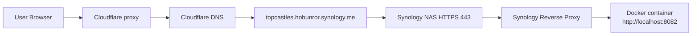

# Topcastles Domain Configuration (topcastles.eu → Synology NAS)

## Purpose

This document describes how to configure the domain `topcastles.eu` to point to a Synology-hosted application running in Docker, using Synology DDNS and Reverse Proxy.

---

## Current Architecture

- Public entrypoint:  
  https://topcastles.eu and https://www.topcastles.eu

- Edge provider and authoritative DNS:
  Cloudflare

- Origin endpoint:
  Synology NAS using `topcastles.hobunror.synology.me`

- Synology Reverse Proxy:
  HTTPS `topcastles.eu` / `www.topcastles.eu` on port `443` -> `http://localhost:8082`

- Application:
  Docker container running on port `8082`

## Architecture Diagram

### Request Flow

1. User opens: https://topcastles.eu
1. Cloudflare receives the request for the proxied hostname.
1. Cloudflare connects to the Synology origin over HTTPS on port `443`.
1. Synology receives the request only from Cloudflare IP ranges.
1. Reverse proxy forwards: https://topcastles.eu -> http://localhost:8082
1. Docker serves: Topcastles Angular/Node app

---

## Goal

Allow users to access the application via:

https://topcastles.eu  
(and optionally https://www.topcastles.eu)

Without exposing internal IP addresses.

---

## Key Principle

Do not publish LAN IPs as public origin DNS records. Synology DDNS provides a
stable target for `www`; a proxied public-IP `A` record also works but must track
WAN address changes.

---

## DNS Configuration

As built on 2026-09-15: Strato remains the registrar, and Cloudflare is the
authoritative DNS provider. Public resolver checks now return the Cloudflare
nameservers and Cloudflare proxy IP addresses for the public hostnames.

Configured Cloudflare nameservers:

- `amanda.ns.cloudflare.com`
- `harvey.ns.cloudflare.com`

Previous Strato nameservers:

- `docks06.rzone.de`
- `shades02.rzone.de`

Cloudflare DNS records reported in the 2026-10-15 incident export:

| Name            | Type    | Target / value                    | Proxy status | Notes                                             |
| --------------- | ------- | --------------------------------- | ------------ | ------------------------------------------------- |
| `topcastles.eu` | `A` | `84.80.47.69` | Proxied | Keep current if the WAN address changes. |
| `www`           | `CNAME` | `topcastles.hobunror.synology.me` | Proxied      | Serves `www.topcastles.eu`.                       |

Both records remained unchanged during the firewall repair. The proxied external
CNAME was not the cause of the 522. The September DNS checks below are historical.

SPF status: no SPF TXT record was visible during DNS verification. If the domain
does not send email, the intended SPF value is `v=spf1 -all`.

Verified public DNS results on 2026-09-15:

| Check | Result |
| --- | --- |
| `topcastles.eu` NS via `1.1.1.1` | `amanda.ns.cloudflare.com`, `harvey.ns.cloudflare.com` |
| `topcastles.eu` A via `1.1.1.1`, `8.8.8.8`, `9.9.9.9` | Cloudflare IPs `104.21.36.7` and `172.67.182.173` |
| `www.topcastles.eu` A via `1.1.1.1` | Cloudflare IPs `104.21.36.7` and `172.67.182.173` |
| `topcastles.eu` TXT/SPF via `1.1.1.1` | No SPF TXT record visible during verification |

## SSL Certificate

As built on 2026-09-15: Cloudflare SSL/TLS mode is **Full (strict)**. The
Synology origin presents a valid certificate for `topcastles.eu` and
`www.topcastles.eu`.

Cloudflare proxied HTTPS uses standard origin port `443`; the public site does
not rely on `:440`.

Verified HTTP results on 2026-09-15: `https://topcastles.eu/` and
`https://www.topcastles.eu/` return Cloudflare headers including
`Server: cloudflare`, `CF-RAY`, and `cf-cache-status`.

## Synology NAS Firewall

As built on 2026-09-15: DSM firewall rules restrict direct origin web traffic.

- The local LAN subnet `192.168.2.0` with subnet mask `255.255.255.0` is allowed
  for NAS administration.
- Cloudflare IPv4 ranges are allowed to TCP ports `80` and `443`.
- All other sources are denied to TCP ports `80` and `443`.
- Built-in Synology application allow rules for Web Station, HTTPS/reverse proxy,
  and Package Portal were excluded because they also use ports `80` and `443` and
  would otherwise bypass the explicit deny rule.
- IPv6 Cloudflare ranges were not added because IPv6 is not used for this setup.

Rule order is significant: LAN allow rules and Cloudflare allow rules must stay
above the deny rule for ports `80` and `443`.

Direct public-IP access from a remote network is now blocked. Direct access from
the allowed LAN may still work by design for administration and local testing.

### Entering Cloudflare ranges in DSM

Use the current [official Cloudflare IPv4 list](https://www.cloudflare.com/ips-v4/).
The table below was checked on 2026-10-15. Recheck the official list when changing
the allowlist; these addresses are not a permanent substitute for it.

In DSM's source-IP editor, enter a subnet with its correct mask, or select an IP
range and enter the complete start/end addresses below. A CIDR prefix such as
`/20` is a mask length, **not** the last octet of the ending address.

| Cloudflare subnet | Range start | Range end |
| --- | --- | --- |
| 173.245.48.0/20 | 173.245.48.0 | 173.245.63.255 |
| 103.21.244.0/22 | 103.21.244.0 | 103.21.247.255 |
| 103.22.200.0/22 | 103.22.200.0 | 103.22.203.255 |
| 103.31.4.0/22 | 103.31.4.0 | 103.31.7.255 |
| 141.101.64.0/18 | 141.101.64.0 | 141.101.127.255 |
| 108.162.192.0/18 | 108.162.192.0 | 108.162.255.255 |
| 190.93.240.0/20 | 190.93.240.0 | 190.93.255.255 |
| 188.114.96.0/20 | 188.114.96.0 | 188.114.111.255 |
| 197.234.240.0/22 | 197.234.240.0 | 197.234.243.255 |
| 198.41.128.0/17 | 198.41.128.0 | 198.41.255.255 |
| 162.158.0.0/15 | 162.158.0.0 | 162.159.255.255 |
| 104.16.0.0/13 | 104.16.0.0 | 104.23.255.255 |
| 104.24.0.0/14 | 104.24.0.0 | 104.27.255.255 |
| 172.64.0.0/13 | 172.64.0.0 | 172.71.255.255 |
| 131.0.72.0/22 | 131.0.72.0 | 131.0.75.255 |

Keep LAN access rules and Cloudflare TCP `80`/`443` allow rules above the final
web-port deny rule. Save/apply changes and confirm the intended profile is active.
Do not disable the firewall or expose Docker port `8082` to resolve a 522.

Incident `topcastles-byny` (2026-10-15): ranges such as `173.245.48.0` through
`173.245.48.20` admitted only a tiny fraction of the intended subnet. Correcting
all 15 ranges restored public access; the operator confirmed success with and
without VPN. No app, image-route, or DNS change was required.

### Cloudflare 522 diagnostics

1. From the home LAN, test the backend:
   `curl.exe --connect-timeout 10 --max-time 20 http://ds224plus.local:8082/api/health`.
   Expect healthy JSON and `imageMount.available=true`.
2. Test DSM HTTPS while preserving the public hostname and TLS SNI:
   `curl.exe -v --connect-timeout 10 --max-time 20 --connect-to www.topcastles.eu:443:ds224plus.local:443 https://www.topcastles.eu/api/health`.
   HTTP 200 verifies the LAN listener, reverse-proxy rule, and backend. If a
   certificate check fails, inspect certificate assignment; `-k` may be used only
   to isolate connectivity, and does not verify certificate validity.
3. Confirm router WAN IPv4 matches the origin address and TCP `80`/`443` forwards
   to the reserved NAS address `192.168.2.14`, on the same internal ports.
4. Inspect complete Cloudflare source ranges and firewall rule ordering above.
5. Verify public health, `/top1000`, and a castle image through the normal proxied
   hostname from an external connection. See [deployment checks](deployment.md#cloudflare-522-while-the-app-works-on-the-lan).

A direct-origin test with `--resolve` or temporarily DNS-only records bypasses
Cloudflare, but the tester's source IP is still subject to the DSM allowlist.
A timeout from mobile data is therefore expected under a Cloudflare-only policy;
it does not prove an ISP or forwarding failure. A home-LAN request to the WAN IP
also depends on router NAT loopback. If the ranges are correct and 522 persists,
inspect router/DSM logs or capture incoming traffic during a proxied request to
locate the drop before changing firewall policy. A command-line Cloudflare 403
challenge is a separate bot-protection result, not evidence of origin failure.
